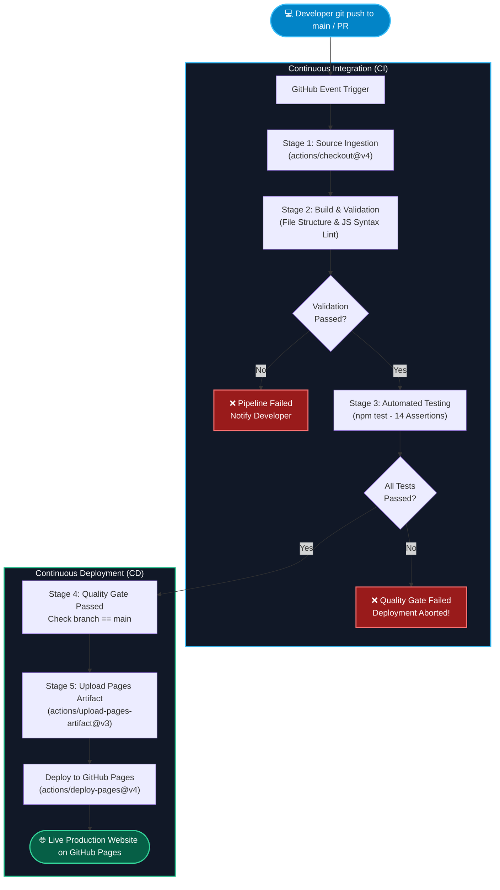

# DevOps Project Tracker — Automated CI/CD Pipeline

> **DecodeLabs Industrial Training Kit — DevOps Project 3: CI/CD Pipeline Basics (Batch 2026)**  
> A production-ready DevOps dashboard with automated Continuous Integration and Continuous Deployment using **GitHub Actions** and zero-config deployment to **GitHub Pages**.

[](https://github.com/<YOUR-GITHUB-USERNAME>/devops-project-3/actions/workflows/ci-cd.yml)
[](https://<YOUR-GITHUB-USERNAME>.github.io/devops-project-3/)
[](LICENSE)
[](https://github.com/)

---

## 📋 Table of Contents
1. [Project Overview](#-project-overview)
2. [Project Objectives](#-project-objectives)
3. [Key Features](#-key-features)
4. [Architecture & CI/CD Pipeline](#-architecture--cicd-pipeline)
5. [Pipeline Stages Explained](#-pipeline-stages-explained)
6. [Repository Structure](#-repository-structure)
7. [Prerequisites](#-prerequisites)
8. [Local Development & Setup](#-local-development--setup)
9. [Running Automated Tests](#-running-automated-tests)
10. [Git & GitHub Step-by-Step Publishing Guide](#-git--github-step-by-step-publishing-guide)
11. [Configuring GitHub Pages](#-configuring-github-pages)
12. [Quality Gate Verification & Intentional Failure Demo](#-quality-gate-verification--intentional-failure-demo)
13. [Troubleshooting & Common Errors](#-troubleshooting--common-errors)
14. [DevOps Learning Outcomes](#-devops-learning-outcomes)
15. [License](#-license)

---

## 🌟 Project Overview

**DevOps Project Tracker** is a sleek, modern web application designed for DevOps engineers to manage sprint tasks, monitor pipeline stages, and visualize automated deployment cycles. 

Instead of manual deployments, this project implements a complete, automated **GitHub Actions CI/CD pipeline**. Whenever code is committed and pushed to the `main` branch, the pipeline automatically:
1. Ingests source code.
2. Validates repository structure and JavaScript syntax.
3. Executes automated unit and regression tests.
4. Enforces a strict **Quality Gate** (blocking deployment if tests fail).
5. Deploys the static assets directly to **GitHub Pages CDN** over HTTPS.

---

## 🎯 Project Objectives

- **Master CI/CD Principles:** Understand the difference between Continuous Integration (building and testing automatically) and Continuous Deployment (delivering changes to production without manual intervention).
- **Automate with GitHub Actions:** Write multi-stage workflows in YAML, configure dependencies between jobs using `needs`, and enforce quality criteria.
- **Implement Automated Testing:** Write comprehensive unit and structural tests using Node.js's native test runner to guarantee application health.
- **Build Quality Gates:** Ensure broken code is stopped before reaching production.
- **Production Hosting:** Configure GitHub Pages with secure OAuth tokens and least-privilege repository permissions.

---

## 🚀 Key Features

- **Modern Glassmorphic Dashboard:** Built with pure HTML5, vanilla CSS3, and ES6+ JavaScript. Features dark-mode aesthetics, custom gradients, and micro-interactions.
- **Interactive Task Management:** 
  - Add, filter, search, and delete DevOps sprint tasks.
  - Multi-criteria filtering by Status (Pending, In Progress, Completed) and Category (CI/CD, Infrastructure, Testing, Security, Monitoring).
  - Cycle task status directly with instant visual badge updates.
  - Client-side persistence using `localStorage`.
  - JSON Export and Backlog Reset options.
- **Sprint KPI Metrics:** Live computation of Total Tasks, In Progress count, Pending items, and Completion percentage bar.
- **Real-Time CI/CD Pipeline Simulator:** Interactive 5-stage pipeline stepper with terminal log console that visually demonstrates workflow execution in real time.
- **Automated Quality Gate Status:** Real-time deployment URL detection, branch indicator, and CI/CD health indicator.

---

## 🏗️ Architecture & CI/CD Pipeline

The following diagram illustrates the automated workflow executed by GitHub Actions:



---

## ⚙️ Pipeline Stages Explained

| Stage | Name | Action / Tool | Objective |
| :--- | :--- | :--- | :--- |
| **Stage 1** | **Source Code Ingestion** | `actions/checkout@v4` | Fetches the latest repository commit on `main` or incoming Pull Request. |
| **Stage 2** | **Build & Validation** | `node scripts/validate-structure.js`<br/>`node --check script.js` | Verifies all 9 mandatory files exist, non-empty, and confirms zero syntax errors. |
| **Stage 3** | **Automated Testing** | `node --test tests/app.test.js` | Executes 14 automated unit tests verifying semantic HTML, DOM IDs, and business logic. |
| **Stage 4** | **Quality Gate** | `needs: [validate, test]` | Blocks deployment if any validation or unit test fails. Guarantees zero bad deployments. |
| **Stage 5** | **Automated Deployment** | `actions/deploy-pages@v4` | Packages files and deploys live to GitHub Pages with HTTPS CDN caching. |

---

## 📂 Repository Structure

```text
devops-project-3/
├── .github/
│   └── workflows/
│       └── ci-cd.yml             # 5-Stage GitHub Actions Workflow definition
├── scripts/
│   └── validate-structure.js     # Stage 2 project file structure validator
├── tests/
│   └── app.test.js               # Stage 3 automated test suite (Node test runner)
├── index.html                    # Dashboard structure & semantic HTML5
├── style.css                     # Responsive design system & glassmorphism theme
├── script.js                     # Task management, pipeline simulator, metrics logic
├── package.json                  # NPM test scripts and metadata
├── .gitignore                    # Ignored files (node_modules, .DS_Store, logs)
├── LICENSE                       # MIT Open Source License
└── README.md                     # Comprehensive project documentation
```

---

## 💻 Prerequisites

To run this project locally on macOS:
1. **macOS** (compatible with Apple Silicon M1/M2/M3 or Intel).
2. **Node.js** v18.0.0 or higher (v20+ LTS recommended). Check with:
   ```bash
   node -v
   ```
3. **Git** v2.20 or higher. Check with:
   ```bash
   git --version
   ```
4. A free **GitHub** personal account.

---

## 🛠️ Local Development & Setup

1. **Clone or navigate to the project directory:**
   ```bash
   cd devops-project-3
   ```

2. **Verify project structure:**
   ```bash
   npm run validate:structure
   ```

3. **Validate JavaScript syntax:**
   ```bash
   npm run lint:syntax
   ```

4. **Launch the web application locally:**
   You can open `index.html` directly in your browser:
   ```bash
   open index.html
   ```
   Or run a lightweight local static HTTP server:
   ```bash
   npx serve .
   ```

---

## 🧪 Running Automated Tests

The project uses Node.js's native test runner (`node:test` and `node:assert/strict`). It runs instantaneously with zero external dependencies.

Run the test suite:
```bash
npm test
```

### Expected Output:
```text
> devops-project-tracker@1.0.0 test
> node --test tests/app.test.js

▶ Stage 2: File Structure & Asset Integrity
  ✔ should verify all mandatory project files exist (0.91ms)
  ✔ should verify package.json has required scripts (0.33ms)
  ✔ should verify GitHub Actions workflow file syntax contains triggers and jobs (0.35ms)
✔ Stage 2: File Structure & Asset Integrity (2.12ms)

▶ Stage 3: HTML Structure & Semantic Elements
  ✔ should contain doctype and HTML5 semantic tags (0.45ms)
  ✔ should define viewport meta tag and SEO description (0.31ms)
  ✔ should contain all required DOM element IDs for interactivity (0.42ms)
✔ Stage 3: HTML Structure & Semantic Elements (1.41ms)

▶ Stage 3: Core Application Business Logic
  ✔ should have valid default training tasks preloaded (0.31ms)
  ▶ validateTaskInput()
    ✔ should approve valid task input (0.12ms)
    ✔ should reject empty or missing task title (0.11ms)
    ✔ should reject titles shorter than 3 characters (0.09ms)
    ✔ should reject invalid priority levels (0.09ms)
  ✔ validateTaskInput() (0.58ms)
  ▶ createTask()
    ✔ should generate a formatted task object with unique ID and timestamp (0.15ms)
    ✔ should throw an error when called with invalid input (0.12ms)
  ✔ createTask() (0.39ms)
  ▶ calculateMetrics()
    ✔ should calculate accurate sprint completion statistics (0.12ms)
    ✔ should handle empty task array safely without divide-by-zero errors (0.08ms)
  ✔ calculateMetrics() (0.32ms)
  ▶ filterTasks()
    ✔ should filter tasks by status (0.12ms)
    ✔ should filter tasks by category (0.11ms)
    ✔ should search tasks case-insensitively across title, category, and description (0.16ms)
  ✔ filterTasks() (0.51ms)
  ▶ toggleTaskStatus() & deleteTask()
    ✔ should cycle task status correctly (0.13ms)
    ✔ should delete task by ID without mutating other tasks (0.11ms)
  ✔ toggleTaskStatus() & deleteTask() (0.36ms)
✔ Stage 3: Core Application Business Logic (2.85ms)

▶ Stage 4: Quality Gate Enforcement
  ✔ should uphold quality gate requirements (0.12ms)
✔ Stage 4: Quality Gate Enforcement (0.22ms)

ℹ tests 14
ℹ suites 8
ℹ pass 14
ℹ fail 0
ℹ duration_ms ~60ms
```

---

## 🐙 Git & GitHub Step-by-Step Publishing Guide

Follow these steps to initialize Git and push the project to your GitHub account:

### Step 1: Initialize Git Repository
In your terminal, inside the project folder:
```bash
git init
```

### Step 2: Configure Default Branch
```bash
git branch -M main
```

### Step 3: Stage and Commit All Files
```bash
git add .
git status
git commit -m "feat: complete DecodeLabs DevOps Project 3 with automated CI/CD pipeline"
```

### Step 4: Create a New GitHub Repository
1. Open your browser and visit: [https://github.com/new](https://github.com/new)
2. Repository Name: `devops-project-3`
3. Description: `DecodeLabs DevOps Project 3: CI/CD Pipeline Basics with GitHub Actions and GitHub Pages`
4. Set visibility to **Public** (required for free GitHub Pages hosting).
5. **Do not** initialize with a README, .gitignore, or license (we already created them).
6. Click **Create repository**.

### Step 5: Link Remote and Push
Replace `<YOUR-GITHUB-USERNAME>` with your actual GitHub username:
```bash
git remote add origin https://github.com/<YOUR-GITHUB-USERNAME>/devops-project-3.git
git push -u origin main
```

---

## 🌐 Configuring GitHub Pages

To allow GitHub Actions to deploy to GitHub Pages:

1. Open your repository on GitHub: `https://github.com/<YOUR-GITHUB-USERNAME>/devops-project-3`
2. Click on **Settings** (top menu bar).
3. In the left sidebar, click **Pages** (under "Code and automation").
4. Under **Build and deployment &rarr; Source**, select:
   👉 **GitHub Actions** (NOT "Deploy from a branch").
5. Click the **Actions** tab at the top of your repository to observe your pipeline running!

Once the workflow finishes, your live website will be accessible at:
```text
https://<YOUR-GITHUB-USERNAME>.github.io/devops-project-3/
```

---

## 🛡️ Quality Gate Verification & Intentional Failure Demo

A crucial DevOps principle is that **a failed test must halt the pipeline and prevent deployment**.

### How to Demonstrate a Quality Gate Failure:

1. Open `tests/app.test.js` or run the test with the simulation flag:
   ```bash
   SIMULATE_PIPELINE_FAILURE=true npm test
   ```
2. You will observe:
   ```text
   ✖ should uphold quality gate requirements
     AssertionError [ERR_ASSERTION]: Simulated Quality Gate Failure: Test failed! Deployment stage must NOT run.
   ```
3. If this commit is pushed to GitHub:
   - **Stage 1 (Ingest):** ✅ Passes
   - **Stage 2 (Validate):** ✅ Passes
   - **Stage 3 (Test):** ❌ **FAILS**
   - **Stage 4 & 5 (Deploy):** 🚫 **BLOCKED & CANCELLED** (Never runs!)
4. To fix it, revert the change or remove the simulation flag, push again, and watch the pipeline turn green and deploy successfully!

---

## 🔍 Troubleshooting & Common Errors

### 1. `Permission to <repo> denied to github-actions[bot]`
- **Cause:** GitHub Actions lacks deployment write permissions.
- **Fix:** In `.github/workflows/ci-cd.yml`, ensure the following block exists at top-level:
  ```yaml
  permissions:
    contents: read
    pages: write
    id-token: write
  ```

### 2. `Invalid workflow file: YAML syntax error`
- **Cause:** Incorrect indentation or tabs in `.github/workflows/ci-cd.yml`.
- **Fix:** YAML strictly requires 2-space indentation. Never use hard tabs. Check with an online YAML validator.

### 3. `GitHub Pages site gives 404 Not Found`
- **Cause:** Repository Pages source is not set to "GitHub Actions" or initial deployment is still pending.
- **Fix:** Go to **Settings &rarr; Pages &rarr; Source &rarr; GitHub Actions**. Check the **Actions** tab to ensure the `deploy` job completed with a green checkmark.

### 4. `node: command not found in runner`
- **Cause:** Node.js was not installed before running npm scripts in GitHub Actions.
- **Fix:** Always include `actions/setup-node@v4` with `node-version: 20` before running `node` or `npm` commands.

---

## 🎓 DevOps Learning Outcomes

By completing DecodeLabs Project 3, the following industry skills were acquired:
- **CI/CD Automation:** Designing end-to-end automated pipelines from code commit to production release.
- **Declarative Pipeline Engineering:** Authoring secure, modular GitHub Actions workflows with jobs, dependencies (`needs`), environments, and concurrency controls.
- **Shift-Left Testing:** Integrating automated structural validation and unit tests into the CI stage before deployment.
- **Zero-Downtime Static Hosting:** Leveraging GitHub Pages CDN with automated artifact bundling and HTTPS certificate provisioning.
- **Quality Gate Governance:** Implementing strict gatekeeping to protect production stability against breaking changes.

---

## 📄 License

This project is licensed under the [MIT License](LICENSE) — free for educational and personal portfolio use.
