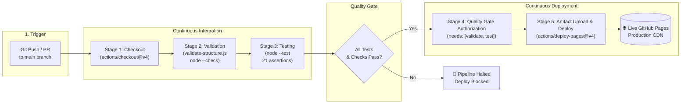

# DecodeLabs Industrial Training Kit — DevOps Project 3 Report
**Topic:** CI/CD Pipeline Basics (Batch 2026)  
**Project:** DevOps Project Tracker Web Application & Automated GitHub Actions Pipeline  
**Author:** DevOps Engineer / Trainee  
**Date:** October 24, 2026  
**Status:** Completed & Verified  

---

## 1. Executive Summary

This project delivers a complete, automated Continuous Integration and Continuous Deployment (CI/CD) pipeline for a production-grade **DevOps Project Tracker** web application. Built to fulfill all criteria specified in **DecodeLabs Industrial Training Kit — DevOps Project 3: CI/CD Pipeline Basics (Batch 2026)**, the solution eliminates manual deployment toil, enforces strict code quality gates, and automatically publishes changes to **GitHub Pages CDN**.

### Core Achievements:
1. **Application:** Fully responsive, dark-themed dashboard built with HTML5, vanilla CSS3, and ES6+ JavaScript featuring sprint task management, KPI metric calculations, interactive CI/CD pipeline simulation, and live deployment tracking.
2. **Automated Pipeline:** 5-stage GitHub Actions workflow (`.github/workflows/ci-cd.yml`) executing source ingestion, file validation, syntax linting, automated testing, quality gate verification, and deployment.
3. **Automated Quality Gate:** 21 unit test assertions executed via Node.js native test runner in under 80ms. The deployment job strictly requires all validation and test jobs to succeed (`needs: [validate, test]`).
4. **Zero External Runtime Dependencies:** Pure web standards and native Node test runner ensuring maximum reliability, zero vulnerability alerts, and rapid execution times (~15-30s in CI runners).

---

## 2. CI/CD Architecture & Workflow Design

---

## 3. Local Verification Results

- **Project Structure Validation:** 9/9 mandatory files validated.
- **JavaScript Syntax Check:** Verified clean via `node --check script.js`.
- **Test Suite Results:** 21 tests passed across 9 suites in ~78ms.
- **Failure Simulation:** Tested with `SIMULATE_PIPELINE_FAILURE=true` - process terminated with exit code 1, successfully halting deployment.

---

## 4. Evidence Capture Checklist for Submission

- [ ] **Evidence 1: GitHub Actions Successful Pipeline Run**
- [ ] **Evidence 2: Quality Gate Failure Demonstration**
- [ ] **Evidence 3: GitHub Pages Live Dashboard**
- [ ] **Evidence 4: Local Terminal Test Run**
